# CLI Reference

This document provides a comprehensive reference for the `axiscam` command-line interface.

## Table of Contents

- [Overview](#overview)
- [Global Options](#global-options)
- [Authentication](#authentication)
- [Core Commands](#core-commands)
- [Command Groups](#command-groups)
- [Workflows](#workflows)
- [Examples](#examples)

---

## Overview

The `axiscam` CLI provides comprehensive management of AXIS network devices via the VAPIX API.

```
axiscam [OPTIONS] COMMAND [ARGS]
```

### Command Structure

```mermaid
flowchart TB
    subgraph "Root Commands"
        INFO[info]
        STATUS[status]
        APIS[apis]
        LLDP[lldp]
        PARAMS[params]
        LOCATION[location]
        REPORT[report]
        VERSION[version]
    end

    subgraph "Configuration"
        CONFIG[config]
        INIT[init]
        MIGRATE[migrate]
        DEVICES[devices]
    end

    subgraph "Command Groups"
        LOGS[logs]
        NETWORK[network]
        SECURITY[security]
        SERVICES[services]
        DOWNLOAD[download]
        AUTOMATION[automation]
        MEDIA[media]
        STREAM[stream]
    end

    CLI[axiscam] --> INFO
    CLI --> STATUS
    CLI --> APIS
    CLI --> LLDP
    CLI --> PARAMS
    CLI --> LOCATION
    CLI --> REPORT
    CLI --> VERSION
    CLI --> CONFIG
    CLI --> INIT
    CLI --> MIGRATE
    CLI --> DEVICES
    CLI --> LOGS
    CLI --> NETWORK
    CLI --> SECURITY
    CLI --> SERVICES
    CLI --> DOWNLOAD
    CLI --> AUTOMATION
    CLI --> MEDIA
    CLI --> STREAM
```

---

## Global Options

Options available for most commands that interact with devices.

| Option | Short | Type | Default | Description |
|--------|-------|------|---------|-------------|
| `--device` | `-d` | `str` | Config default | Device name from config |
| `--host` | `-H` | `str` | - | Direct IP/hostname (overrides --device) |
| `--username` | `-u` | `str` | Config value | Authentication username |
| `--password` | `-p` | `str` | Config value | Authentication password |
| `--port` | `-P` | `int` | config port, else `443` | TCP port. An explicit value always overrides the device's configured port |
| `--auth` | - | `auto\|basic\|digest` | `auto` | Follow the device's challenge, or force a scheme |
| `--json` | `-j` | `bool` | `False` | Output as JSON |
| `--all` | - | `bool` | `False` | Fleet: run against every configured device (read-only commands: `info`, `security audit`, `accounts list`, `onvif list`, `backup create`) |
| `--group` | `-g` | `str` | - | Fleet: devices whose `groups:` tags contain NAME or whose `type` is NAME |
| `--concurrency` | - | `int` | `4` (`2` for backups) | Fleet: devices worked on at once |

### Option Precedence

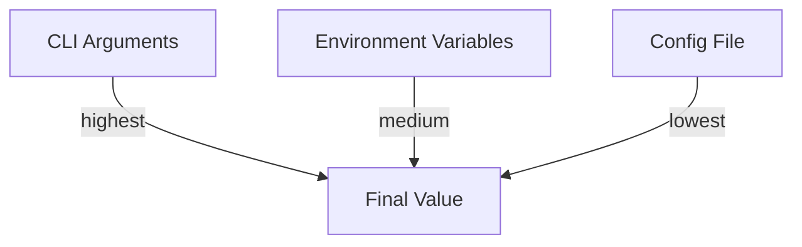

1. **CLI Arguments** (highest priority)
2. **Environment Variables** (`AXIS_*`)
3. **Config File** (`~/.config/axiscam/config.yaml`)

---

## Authentication

### Basic vs Digest Authentication

Axis's guidance is Basic over HTTPS and Digest over HTTP, and devices differ: an
AXIS OS 12 camera with `Network.HTTP.AuthenticationPolicy=recommended` offers
*only* Basic on HTTPS and rejects Digest; an AXIS OS 11 speaker offers only
Digest. `--auth auto` (the default) starts with the scheme Axis recommends for
the transport and, if the device answers 401 offering only the other scheme,
switches once and remembers for the session. A 401 that offers the same scheme
is a genuine credential failure. Basic over plain HTTP is never chosen
automatically.

```bash
# Default: follow the device
axiscam info --device front_camera

# Force a scheme (diagnosis)
axiscam info --device front_camera --auth digest
axiscam info --device front_camera --auth basic
```

### Environment Variables

```bash
export AXIS_HOST=192.168.1.10
export AXIS_USERNAME=root
export AXIS_PASSWORD=secure_password
export AXIS_PORT=443
```

### Secrets in .env File

```bash
# ~/.config/axiscam/.env
AXIS_ROOT_USER_NAME=root
AXIS_ROOT_USER_PASSWORD=your_secure_password
```

---

## Core Commands

### info

Get comprehensive device information.

```bash
axiscam info [OPTIONS]
```

| Option | Description |
|--------|-------------|
| `--device, -d` | Device name |
| `--host, -H` | Direct IP address |
| `--json, -j` | Output as JSON |

**Example:**
```bash
$ axiscam info --device front_camera

Device Information:
  Brand: AXIS
  Model: M3216-LVE
  Product: AXIS M3216-LVE Dome Camera
  Serial: B8A44F9F0228
  Firmware: 12.7.61
  Hardware ID: 93A.2
  Architecture: aarch64
  SoC: Axis Artpec-8
```

---

### status

Check device connectivity and health.

```bash
axiscam status [OPTIONS]
```

**Example:**
```bash
$ axiscam status --device front_camera

✅ Device front_camera (192.168.1.10) is reachable
  Model: M3216-LVE
  Firmware: 12.7.61
  Serial: B8A44F9F0228
```

---

### apis

List available VAPIX APIs on the device.

```bash
axiscam apis [OPTIONS]
```

**Example:**
```bash
$ axiscam apis --device front_camera

Available APIs:
  basic-device-info (v2beta)
  param (v1.3)
  network-settings (v1)
  lldp (v1)
  firewall (v1)
  ...
```

---

### params

List or export device parameters.

```bash
axiscam params [OPTIONS]
```

| Option | Description |
|--------|-------------|
| `--group` | Parameter group (e.g., "Network") |
| `--export` | Export every parameter as `{"root.Group.Name": "value"}` (JSON) |
| `--output, -o` | Output file path |

**Example:**
```bash
# List specific group
$ axiscam params --device front_camera --group Network

# Export all parameters to file
$ axiscam params --device front_camera --export --output params.json
```

---

### lldp

Show LLDP neighbor discovery information (switch port mapping).

```bash
axiscam lldp [OPTIONS]
```

**Example:**
```bash
$ axiscam lldp --device front_camera

LLDP Status: Enabled
Neighbors:
  System: BobUSWLite8PoE
  Port: Port 2
  Port Description: b8_a4_4f_9f_02_28
```

---

### report

Generate comprehensive device configuration report.

```bash
axiscam report [OPTIONS]
```

| Option | Short | Description |
|--------|-------|-------------|
| `--output` | `-o` | Output file path |
| `--format` | `-f` | Format: `json`, `yaml`, `text` |
| `--full` | - | Include every resource the device advertises |

**Example:**
```bash
# Summary report
$ axiscam report --device front_camera --format json --output report.json

# Everything the device advertises
$ axiscam report --device front_camera --full --output full_report.json
```

**What is included.** The report is driven by the API module registry: it asks the
device which APIs it advertises (`/config/discover/apis`) and reads each
matching module. The summary report covers `device_info`, `time`, `network`,
`lldp`, `stream`, `firewall` and `ntp`; `--full` reads every available resource
(additionally `ssh`, `snmp`, `cert`, `action`, `mqtt`, `recording`, `storage`,
`geolocation`, `analytics`, `snapshot`, `analytics_mqtt`, `audio_multicast`,
`oidc`, `oauth`, `virtualhost`, `crypto_policy`, `networkpairing`). A module
added to the registry appears in `--full` automatically.

**Output shape** (`json` / `yaml`):

```json
{
  "device": "front_camera",
  "generated_at": "2026-10-13T09:00:00+00:00",
  "sections": {
    "device_info": { "product_number": "M3216-LVE", "serial_number": "...", "firmware_version": "12.1.60" },
    "ssh": { "enabled": false, "port": 22, "..." : "..." }
  },
  "errors": { "ntp": "Device error: 500" },
  "skipped": ["stream"]
}
```

- `sections` — one entry per module read, keyed by module name, holding the full
  model (`model_dump(mode="json")`).
- `errors` — modules the device advertises but that failed to read. Authentication
  and connection failures are not per-module errors: the command exits 1.
- `skipped` — requested modules the device does not advertise (not an error).

`--format text` prints a short summary (model, serial, firmware, IP, MAC, LLDP
neighbour) followed by any errors and skipped modules.

---

### location

Show device geolocation configuration.

```bash
axiscam location [OPTIONS]
```

**Example:**
```bash
$ axiscam location --device front_camera

Geolocation:
  Latitude: 37.7749
  Longitude: -122.4194
  Altitude: 10.5m
  Direction: 45°
```

---

## Command Groups

### logs

Retrieve device logs. Each type is read from its dedicated CGI
(`systemlog.cgi`, `accesslog.cgi`, `auditlog.cgi`); the server-report tarball
is used only when a device lacks the CGI (older firmware; audit log needs
AXIS OS 12.7+) and for `logs all`. The header line names the source that
answered. For the audit log, `--lines N` is passed to the device as `tail=N` so
only that many entries are transferred.

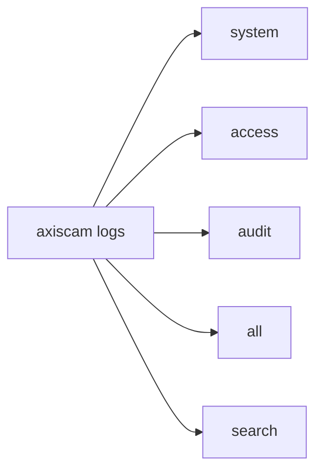

#### logs system

```bash
axiscam logs system [OPTIONS]

Options:
  --device, -d    Device name
  --lines, -n     Number of lines (default: 50)
```

#### logs access

```bash
axiscam logs access [OPTIONS]

Options:
  --device, -d    Device name
  --lines, -n     Number of lines
```

#### logs audit

```bash
axiscam logs audit [OPTIONS]

Options:
  --device, -d    Device name
  --lines, -n     Number of lines
```

#### logs all

```bash
axiscam logs all [OPTIONS]

Options:
  --device, -d    Device name
  --lines, -n     Number of lines per log type
```

#### logs search

```bash
axiscam logs search [OPTIONS] PATTERN

Options:
  --device, -d    Device name
  --type, -t      Log type (system, access, audit)
```

**Examples:**
```bash
# Get last 50 system log entries
$ axiscam logs system --device front_camera --lines 50

# Get access logs
$ axiscam logs access --device front_camera

# Search for errors
$ axiscam logs search "error" --device front_camera
```

---

### network

Network configuration commands.

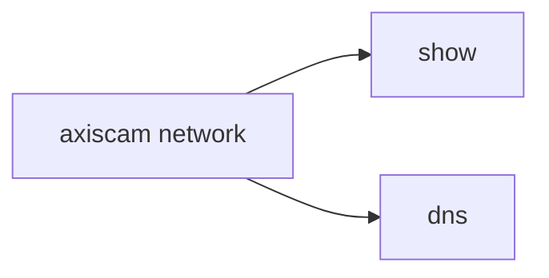

#### network show

```bash
axiscam network show [OPTIONS]

Options:
  --device, -d    Device name
  --json, -j      Output as JSON
```

#### network dns

```bash
axiscam network dns [OPTIONS]

Options:
  --device, -d    Device name
```

**Examples:**
```bash
# Show network configuration
$ axiscam network show --device front_camera

# Show DNS settings
$ axiscam network dns --device front_camera
```

---

### security

Security configuration readers and the hardening audit.

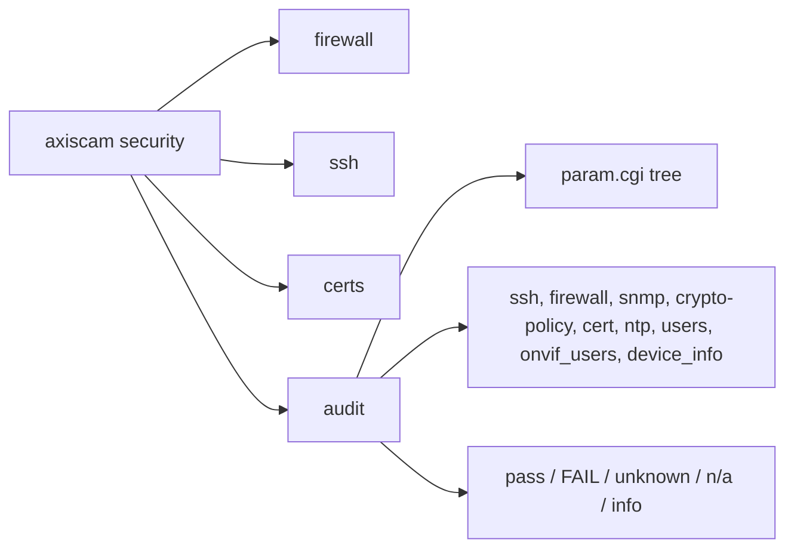

```bash
axiscam security firewall [--json] [OPTIONS]   # activated, default policy, active and pending rules
axiscam security ssh [--json] [OPTIONS]        # Network.SSH.Enabled + the SSH users
axiscam security certs [--json] [OPTIONS]      # device and CA certificates (parsed from PEM), keystores
axiscam security audit [--show-all] [--json] [--no-fail] [--all | --group NAME] [--concurrency N] [OPTIONS]
```

**`audit`** checks the device against the [AXIS OS Hardening Guide](https://help.axis.com/en-us/axis-os-hardening-guide)
(July 2026 edition), read-only. The guide's "Basic hardening via VAPIX API" table
names a parameter and a hardened value for each basic recommendation; those are
checked verbatim (Bonjour, UPnP, Zero-Conf, WS-Discovery, O3C, SSH, FTP, ARP/Ping,
script editor, web interface, TLS 1.0/1.1, access log, ONVIF replay protection,
server tokens, brute-force delay, HTTPS). On top: HTTPS-only per role
(`System.BoaGroupPolicy.*`), HTTP authentication policy, the TLS 1.2 cipher list
against the guide's, remote syslog, a dedicated non-admin account and unknown
administrators (AXIS OS Forensics Guide), ONVIF users, SNMP v1/v2c and default
community, firewall activated with DROP, crypto policy, NTP synced, certificates
expiring within 90 days or self-signed, firmware version (recorded, not compared
online).

| Status | Meaning |
|--------|---------|
| `pass` / `FAIL` | The setting was read and compared |
| `unknown` | Could not read (403, 404, missing parameter): **never** counted as pass or fail |
| `n/a` | The product does not have the setting (AXIS OS 12 removed FTP and TLS 1.0/1.1): nothing to harden |
| `info` | Recorded for the record (administrators, ONVIF users, firmware) |

Exit status is 1 when any check fails; `--no-fail` for reporting pipelines.
Passing and n/a checks are hidden unless `--show-all`. `--json` gives
`{counts, findings[{id, title, status, severity, evidence, recommendation, reference}]}`.

With `--all` / `--group` the audit runs across the fleet and prints a summary
(failing / passing / unknown per device) and a matrix of the checks that fail
or are unknown on at least one device, devices as columns. Exit 1 if any check
fails anywhere or any device could not be audited. JSON:
`{devices: {name: {host, ok, result | error}}, failed: [...]}`.

**Examples:**
```bash
$ axiscam security audit --device front_camera
$ axiscam security audit --device front_camera --json --no-fail | jq '.findings[] | select(.status=="fail") | .id'
$ axiscam security audit --group camera               # the cameras, as a checks × devices matrix
```

### services

Service configuration commands.

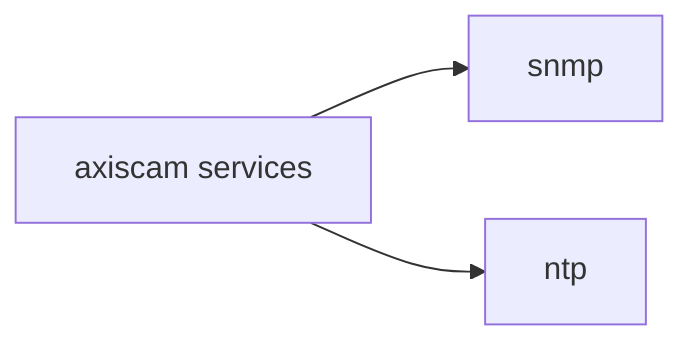

#### services snmp

```bash
axiscam services snmp [OPTIONS]

Options:
  --device, -d    Device name
```

#### services ntp

```bash
axiscam services ntp [OPTIONS]

Options:
  --device, -d    Device name
```

---

### download

Download the server report and the crash report. Every file is written with
`0600` permissions (`axis_cam.files.write_private`).

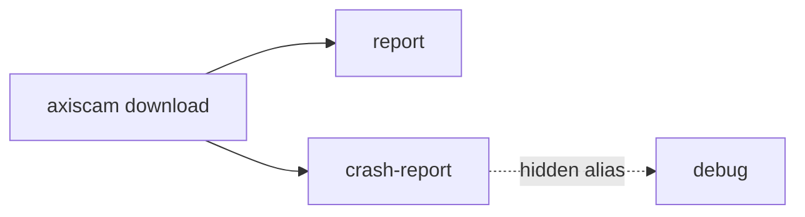

#### download report

Download server report from device.

```bash
axiscam download report [OPTIONS]

Options:
  --device, -d    Device name
  --output, -o    Output file path
  --format, -f    Report format (zip_with_image, zip, text)
  --timeout, -t   Download timeout in seconds (default: 60)
  --auth auto|basic|digest    Authentication scheme (default: auto)
```

**Formats:**
| Format | Description |
|--------|-------------|
| `zip_with_image` | ZIP with diagnostic snapshot (default) |
| `zip` | ZIP without image |
| `text` | Plain text report |

#### download crash-report

Download the crash report (`/axis-cgi/debug/debug.tgz`): what the web interface
calls "Download the crash report" — the server report plus detailed debug data
such as core dumps and network traces. The command prints Axis's privacy notice
first (the archive can include user IDs, passwords, video images and network
traffic) and writes the file `0600`. `axiscam download debug` is a hidden alias.

```bash
axiscam download crash-report [OPTIONS]

Options:
  --device, -d    Device name
  --output, -o    Output file path (default: crash_report_<device>.tgz)
  --timeout, -t   Download timeout in seconds (default: 300; the device builds the archive on demand)
  --auth auto|basic|digest    Authentication scheme (default: auto)
```

**Examples:**
```bash
# Download server report with snapshot
$ axiscam download report --device front_camera --output ~/report.zip

# Download server report as text
$ axiscam download report --device front_camera --format text --output ~/report.txt

# Download the crash report (large; the device takes minutes to build it)
$ axiscam download crash-report --device front_camera --output ~/crash.tgz --timeout 600
```

---

### stream

Stream diagnostics commands.


#### stream show

Show RTSP, RTP, and stream profile configuration.

```bash
axiscam stream show [OPTIONS]

Options:
  --device, -d    Device name
  --json, -j      Output as JSON
```

**Example:**
```bash
$ axiscam stream show --device front_camera

Stream Diagnostics:
  RTSP:
    Port: 554
    Authentication: digest
  RTP:
    Port Range: 50000-50999
    Multicast: disabled
  Profiles:
    - Profile1: H.264, 1920x1080, 30fps
    - Profile2: MJPEG, 640x480, 15fps
```

---

### automation

Automation configuration commands.

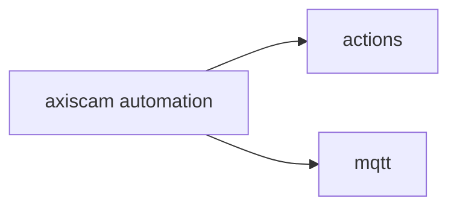

---

### media

Media configuration commands.

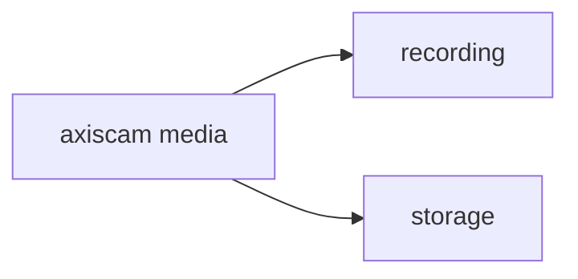

---

### accounts

User accounts via `pwdgrp.cgi`. These are the first commands that write to a
device, and they all follow the same write-safety pattern:

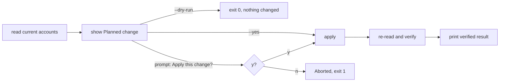

```bash
axiscam accounts list [--json] [OPTIONS]
axiscam accounts add ACCOUNT --role viewer|operator|admin [--ptz] [--comment TEXT]
                              [--password-stdin] [--no-strict] [--yes] [--dry-run] [OPTIONS]
axiscam accounts set-password ACCOUNT [--password-stdin] [--no-strict] [--yes] [--dry-run] [OPTIONS]
axiscam accounts set-role ACCOUNT --role ROLE [--ptz] [--allow-lockout] [--yes] [--dry-run] [OPTIONS]
axiscam accounts remove ACCOUNT [--allow-lockout] [--yes] [--dry-run] [OPTIONS]
```

| Option | Description |
|--------|-------------|
| `--role`, `-r` | `viewer`, `operator` or `admin` (VAPIX roles are cumulative) |
| `--ptz/--no-ptz` | Grant PTZ control (default: no) |
| `--password-stdin` | Read the **new account's** password from standard input (one line). Without it, the password is prompted for, hidden, after the plan is accepted. It is never a command-line argument. |
| `--no-strict` | Do not send `strict_pwd=1`; the device will not enforce its passphrase policy |
| `--allow-lockout` | Permit removing or de-admining the account you are logged in as |
| `--yes`, `-y` | Apply without the confirmation prompt |
| `--dry-run` | Show the planned change and exit 0 |

**Rules the library enforces** (the plan warns about them in advance):

- The device reports failures with HTTP 200 and an `Error:` body; these become one-line errors (`invalid password` → passphrase policy, `account user name` → character rules).
- `add`, `set-role` and `remove` are verified by re-reading the account list; `set-password` cannot be verified by reading, so the device's acknowledgement is the result — test by logging in.
- Removing or de-admining the authenticated account is refused without `--allow-lockout`.
- Removing or de-admining the **only** administrator is refused outright.
- Account names: 1–14 characters, `A-Z a-z 0-9`. Passwords: 1–64 characters, printable ASCII under `strict_pwd`.

**Examples:**
```bash
$ axiscam accounts list --device front_camera
$ axiscam accounts add ops --role operator --device front_camera          # prompts for the password
$ echo "$PW" | axiscam accounts set-password ops --password-stdin -y --device front_camera
$ axiscam accounts remove ops --dry-run --device front_camera
```

---

### onvif

ONVIF users — a **separate database** from the VAPIX accounts above. A VMS,
NVR or Home Assistant that talks ONVIF logs in with one of these, and
`accounts list` does not show them. Same write-safety pattern as `accounts`.

```bash
axiscam onvif list [--json] [OPTIONS]
axiscam onvif add USER --level administrator|operator|user [--password-stdin] [--yes] [--dry-run] [OPTIONS]
axiscam onvif set-password USER [--password-stdin] [--yes] [--dry-run] [OPTIONS]
axiscam onvif set-level USER --level LEVEL [--password-stdin] [--allow-lockout] [--yes] [--dry-run] [OPTIONS]
axiscam onvif remove USER [--allow-lockout] [--yes] [--dry-run] [OPTIONS]
```

| Option | Description |
|--------|-------------|
| `--level`, `-l` | ONVIF `UserLevel`: `administrator`, `operator` or `user` |
| `--password-stdin` | Read the **ONVIF user's** password from standard input (one line). Otherwise it is prompted for, hidden, after the plan is accepted. Never a command-line argument. |
| `--allow-lockout` | Permit removing or demoting the only ONVIF Administrator |
| `--yes`, `-y` | Apply without the confirmation prompt |
| `--dry-run` | Show the planned change and exit 0 |

**Rules the library enforces** (the plan warns about them in advance):

- Transport is ONVIF Device Management SOAP on `POST /vapix/services`, which accepts the device's VAPIX administrator credentials (verified on AXIS OS 12.11 and 11.11). Device refusals are SOAP faults; they are shown with the ONVIF code (`ter:UsernameClash`, `ter:Password` = too weak, `ter:FixedUser`).
- `add`, `set-level` and `remove` are verified by re-reading the list; `set-password` cannot be — ONVIF never returns passwords — so verify by connecting the client.
- `set-level` asks for the user's password: the device refuses a `SetUser` without one (`ter:InvalidArgs`). Enter the current password to keep the user's clients working, or a new one to rotate it in the same step.
- `set-password` warns that every ONVIF client using that user must be updated.
- Removing or demoting the **only** ONVIF Administrator is refused without `--allow-lockout`.

**Examples:**
```bash
$ axiscam onvif list --device front_camera
$ axiscam onvif add frigate --level operator --device front_camera          # prompts for the password
$ echo "$PW" | axiscam onvif set-password frigate --password-stdin -y --device front_camera
$ axiscam onvif remove frigate --dry-run --device front_camera
```

---

### backup

Configuration backups. `create` reads the device and never writes to it; `show`
and `verify` need only the directory.

```mermaid
flowchart LR
    CREATE[axiscam backup create] --> DIR["backup-&lt;device&gt;-&lt;UTC ts&gt;/"]
    DIR --> M[manifest.json]
    DIR --> R["&lt;module&gt;.json × N"]
    DIR --> P[params.json]
    DIR -.--with-server-report.-> S[server-report.zip]
    M --> SHOW[axiscam backup show]
    M --> VERIFY[axiscam backup verify]
```

```bash
axiscam backup create [-o PARENT_DIR] [--with-server-report] [OPTIONS]
axiscam backup show BACKUP_DIR [--json]
axiscam backup verify BACKUP_DIR
axiscam backup restore BACKUP_DIR [--include-network] [--include-secrets] [-v] [--yes] [--dry-run] [OPTIONS]
```

| Option | Description |
|--------|-------------|
| `--output`, `-o` | Parent directory; the backup directory is created inside it (default: current directory) |
| `--with-server-report` | Also download the server report (zip with image) into the backup |

**What a backup holds.** One `<module>.json` per resource the device advertises
(the same modules `report --full` reads), `params.json` with the whole parameter
tree as `{"root.Group.Name": "value"}`, and `manifest.json` with the tool
version, device identity, a SHA-256 and source per file, per-module errors, the
modules the device does not advertise, and two explicit lists:

- **not included by design** — VAPIX gives no client a way to read these: account
  passwords and hashes, certificate private keys, ACAP binaries and licence keys,
  recordings and edge-storage content, the device's own TLS/SSH host keys;
- **not implemented** — readable in principle, not read by this version: ONVIF
  users, the installed ACAP list, stream profiles beyond the stream module, view
  areas / PTZ presets / guard tours, overlays.

The directory is created `0700` and every file `0600`. `verify` re-hashes each
file and exits 1 on a mismatch, a missing file or a file the manifest does not
list.

**Restore** is deliberately narrow: it restores `params.json` through
`param.cgi?action=update`, the one write path VAPIX documents for the parameter
tree. The per-module REST APIs are not written. The flow is the same write-safety
pattern as `accounts`:

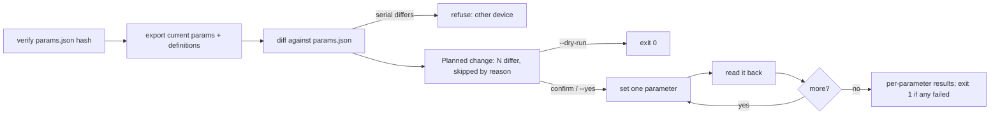

- Skipped with a reason: unchanged; read-only on this device (the plan asks
  `param.cgi?action=listdefinitions` which parameters the device lets anyone
  write — `Brand.*`, most of `Properties.*`, `*.NbrOfConfigs`, …); `Network`
  unless `--include-network` (a wrong address cuts this connection); credential
  parameters (`*Password*`, `*Community*`, `*PSK*`, …) unless `--include-secrets`
  — their values are never printed, even with `-v`; parameters
  the device no longer has.
- `params.json` is checked against the manifest's hash before anything is read
  from it; a damaged or hand-edited file is refused with exit 1.
- Immediately before the first write the device is read again. If its serial
  number is not the backup's, or any planned parameter no longer has the value
  the plan showed (someone changed it while you were reading the plan), the run
  is refused with exit 1 and nothing is written; the drifted parameters are
  named, never their values. Run the restore again for a fresh plan.
- The device's refusal of a parameter (`# Error: Error setting …`) is recorded
  for that parameter and the run continues; a 401 or a connection failure aborts.
- `-v` lists every change as `name: 'current' -> 'target'`.

**Examples:**
```bash
$ axiscam backup create --device front_camera -o ~/backups
$ axiscam backup show ~/backups/backup-front_camera-20261013T110000Z
$ axiscam backup verify ~/backups/backup-front_camera-20261013T110000Z
```

---

### Configuration Commands

#### config

Show current configuration.

```bash
$ axiscam config

Configuration:
  Path: ~/.config/axiscam/config.yaml
  Default Device: front_camera
  Devices: 4 configured
```

#### init

Initialize configuration with defaults.

```bash
axiscam init [OPTIONS]

Options:
  --force    Overwrite existing configuration
```

#### devices

List all configured devices.

```bash
$ axiscam devices

Configured Devices:
  front_camera (camera) - 192.168.1.10
  main_nvr (recorder) - 192.168.1.100
  front_intercom (intercom) - 192.168.1.12
  office_speaker (speaker) - 192.168.1.45
```

#### migrate

Migrate from legacy configuration path.

```bash
$ axiscam migrate

Migrating from ~/.config/axis/ to ~/.config/axiscam/...
✅ Configuration migrated successfully
```

---

## Workflows

### Device Discovery Workflow

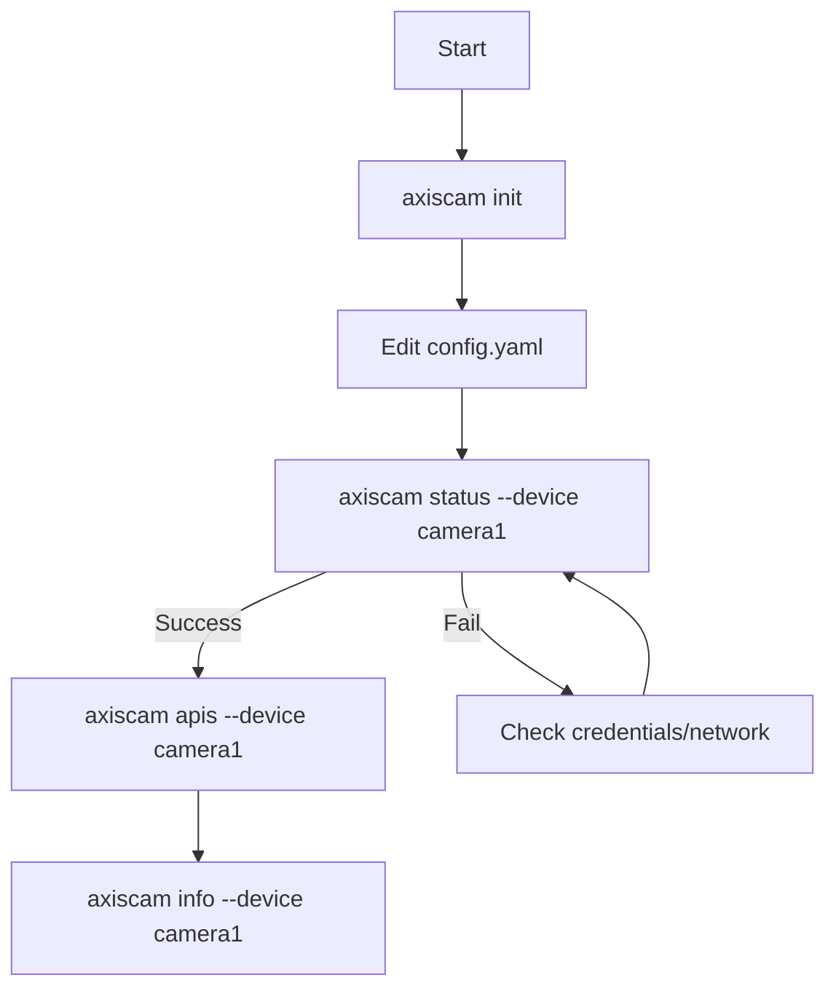

### Troubleshooting Workflow

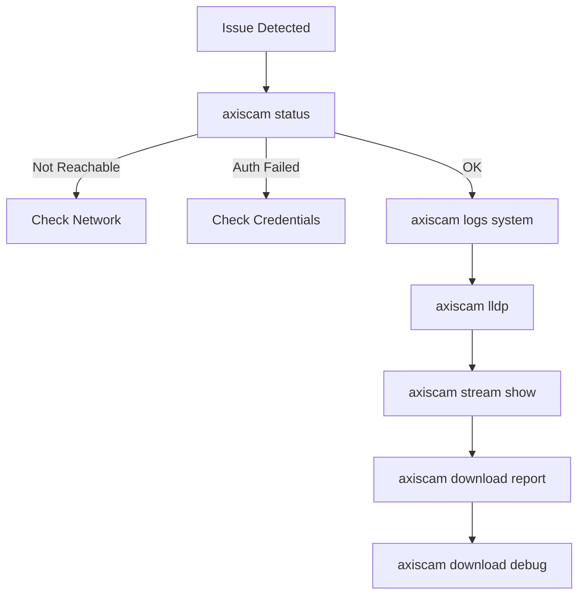

### Full Configuration Export

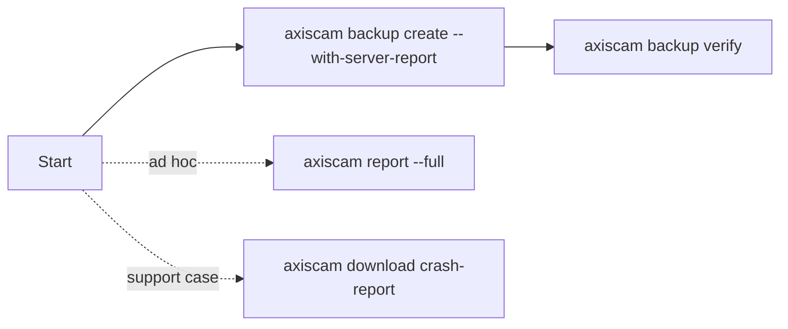

`backup create` supersedes chaining `report --full`, `params --export` and
`download report` by hand: one directory, one manifest, verifiable later.

---

## Examples

### Quick Device Check

```bash
# Check device status
axiscam status --device front_camera

# Get device info
axiscam info --device front_camera

# List APIs
axiscam apis --device front_camera
```

### Network Diagnostics

```bash
# LLDP neighbors (switch port mapping)
axiscam lldp --device front_camera

# Network configuration
axiscam network show --device front_camera

# DNS settings
axiscam network dns --device front_camera
```

### Stream Troubleshooting

```bash
# Stream diagnostics
axiscam stream show --device front_camera --json

# Full device report
axiscam report --device front_camera --full --output config.json
```

### Log Analysis

```bash
# System logs
axiscam logs system --device front_camera --lines 100

# Search for errors
axiscam logs search "error" --device front_camera

# All logs
axiscam logs all --device front_camera
```

### Security Audit

```bash
# Firewall status
axiscam security firewall --device front_camera

# SSH configuration
axiscam security ssh --device front_camera

# Certificates
axiscam security certs --device front_camera
```

### Diagnostic Export

```bash
# Server report with snapshot
axiscam download report --device front_camera --output ~/camera_report.zip

# Debug archive for support
axiscam download debug --device front_camera --output ~/camera_debug.tgz --timeout 180
```

### Multi-Device Operations

```bash
# Loop through devices
for device in front_camera back_camera side_camera; do
    echo "=== $device ==="
    axiscam status --device $device
done

# Export all reports
for device in $(axiscam devices --json | jq -r '.[] | .name'); do
    axiscam report --device $device --full --output "${device}_report.json"
done
```

### JSON Output for Scripting

```bash
# Parse JSON output
axiscam info --device front_camera --json | jq '.serial_number'

# Get RTSP port
axiscam stream show --device front_camera --json | jq '.rtsp.port'

# Filter logs
axiscam logs system --device front_camera --json | jq '.entries[] | select(.severity == "ERROR")'
```

---

## See Also

- [Architecture Overview](./architecture.md) - System architecture
- [Configuration Guide](./configuration.md) - Configuration system
- [Device Classes](./device-classes.md) - Device implementations
- [API Modules](./api-modules.md) - API reference
