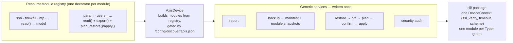

# axiscam — admin features and modularity: review and phased plan

- **Date:** 2026-10-12
- **Status:** Phase 0 complete; Phase 1 in progress (see [Phase status](#phase-status))
- **Baseline measured:** 452 tests pass · 53% coverage (`uv run pytest --cov=src/axis_cam`) · ruff clean · pyright clean
- **Repo state at review:** local `main` was 5 ahead / 5 behind `origin/main` (diverged). Phase 0 work is on branch `phase-0-security-fixes`, cut from local `main`. Reconciling `main` with `origin/main` is a separate owner decision — nothing here pushes.

## TL;DR

The library is a clean, consistent, read-only VAPIX client with good Pydantic models and a sensible one-module-per-API decomposition. Three things block the requested goals:

1. Two silent transport-security bugs in the CLI path (TLS verification never enabled; scheme inferred from port).
2. A coverage gate that measures nothing.
3. A four-file edit tax per API module that makes "full backup/restore" and generic admin commands impractical without a registry-style refactor.

Two requested goals are already met (server report with image by default; debug archive = crash report). One needs an expectation reset: **AXIS OS has no native full backup/restore API.** "Full" has to be composed per module, and some state is unrestorable through VAPIX by design.

## Goals vs. current state

| Goal | State | Evidence |
|---|---|---|
| Server report, image by default | Done | `download report` defaults to `zip_with_image` (`src/axis_cam/cli.py`) |
| Crash report | Done, misnamed | `download debug` → `/axis-cgi/debug/debug.tgz`. Axis's [server/crash report privacy statement](https://www.axis.com/support/technical-notes/server-and-crash-report-privacy-statement) describes the crash report as the server report plus debug data that "can include user IDs, passwords, video images, network traffic". One DevTools capture of the web UI's "Download the crash report" confirms the URL; then alias `download crash-report` and warn on save. |
| Logs: system / access / audit | Exists, wrong mechanism | All three download the entire `tar_all` server report and grep filenames (`LOG_FILE_PATTERNS`, `src/axis_cam/api/logs.py`). Axis has a dedicated [`auditlog.cgi?tail=N`](https://developer.axis.com/vapix/network-video/audit-log/) and `systemlog.cgi` ([system settings](https://developer.axis.com/vapix/network-video/system-settings/)). `search_logs` and `get_log_summary` re-download the tar. |
| Users: Accounts | Missing | `pwdgrp.cgi` — verified, see [Feature gaps](#feature-gaps--verified-endpoints-and-constraints) |
| Users: ONVIF | Missing | Separate user database; ONVIF SOAP, not VAPIX |
| Backup (full) | Missing | Only `params --export` (param tree, ambiguous shape) |
| Restore (full) | Missing | No native endpoint exists |
| Modular / ResourceModule | Missing | See [Architecture](#architecture-and-the-resourcemodule-idea) |

## Findings by severity

Legend: 🔴 bug · 🟡 improvement · 🔵 style/hygiene

### 🔴 Bugs

1. **TLS verification is always off from the CLI, regardless of config.** `resolve_device_config` (`src/axis_cam/cli.py`) returns `(host, user, pw, port, type)` and drops `DeviceConfig.ssl_verify` and the app `timeout`. Every command then builds `device_class(host, user, pw, port, use_digest_auth=digest)` → `ssl_verify=False`. The README documents `ssl_verify:` per device; it is a no-op. A user who sets `ssl_verify: true` believes they are protected against MITM and is not.
2. **Transport scheme is inferred from the port.** `src/axis_cam/devices/base.py`: `use_https = port == 443`. A device on 8443 is contacted over plaintext HTTP. Combined with the library default `use_digest_auth=False`, that is Basic-auth credentials in cleartext. Fix: explicit `https: bool = True` in `DeviceConfig` and constructors; refuse Basic over HTTP unless explicitly allowed.
3. **The coverage gate is theatre.** `.pre-commit-config.yaml` ran `uv run pytest --cov-fail-under=90` without `--cov=`; verified: 452 passed, exit 0, no coverage measured. Real coverage 53%; 22 of 27 API modules at 17–29%, `cli.py` at 12%. pyproject said 80, hook said 90. Fix: measure coverage in the hook, one threshold in pyproject set at the measured baseline and ratcheted upward per phase.
4. **Log sorting crashes on mixed timestamp awareness.** `src/axis_cam/api/logs.py`: ISO timestamps with offsets (Axis emits `2025-07-22T15:38:25.307+00:00`) parse tz-aware; unparsed/continuation lines get naive `datetime.now()`. `get_logs` then sorts → `TypeError: can't compare offset-naive and offset-aware datetimes`. Latent (not reproduced on a device) but any multi-line syslog message triggers it. `now()` on unparsed lines also floats them to the top of a newest-first sort.
5. **83 `except Exception` sites across 32 files swallow auth and connection errors.** Example: `SshAPI.get_config` on a 403 returns `SshConfig(enabled=False)`. For a security tool, "could not read" rendering as "disabled" is a false negative. Fix: catch `AxisDeviceError`/`AxisApiNotSupportedError` narrowly in API/device modules; let `AxisAuthenticationError`/`AxisConnectionError` propagate; add one top-level `AxisError` handler in the CLI. Four of the 62 non-CLI sites wrap non-HTTP code (enum parsing in `cert.py`/`firewall.py`, `model_validate` in `lldp.py`, tar member decode in `logs.py`) and need their own narrow exception types.

### 🟡 Improvements

6. `--password` on the command line lands in shell history and `ps`. Add `AXIS_PASSWORD` env for ad-hoc `--host` use and a hidden interactive prompt fallback.
7. `.env` is read by `config.load_env_file` but was not in `.gitignore`.
8. `ParamAPI.export()` falls back to a different dict shape on any exception; a restore cannot tell which shape a file holds.
9. `--port 443` is a sentinel (`port if port != 443 else config.port`); an explicit 443 cannot override a config port.
10. Auth defaults disagree: CLI `digest=True`, library `use_digest_auth=False`, README says "Digest (default)".
11. README claims "Efficient parallel communication with multiple devices"; there is no multi-device fan-out anywhere.
12. Typer's pretty exceptions show local variables by default, which include `passwd`; set `pretty_exceptions_show_locals=False`.

### 🔵 Style / hygiene

13. `AxisDevice` carries 27 one-line pass-through wrappers (`get_ssh_config()` → `self.ssh.get_config()`). `BaseAPI(ABC)` has no abstract methods (`# noqa: B024`). `LogsAPI.__init__(client: Any)`. `.gitignore` had its agent/IDE block duplicated. `specs/` is ignored while `src/specs/` is a tracked near-duplicate. Empty `src/docs/`. Terraform hooks in a pure-Python repo. `mypy --strict` configured, pyright is what runs. The `device report --full` comment says "Full configuration export" but it is a hand-picked summary.

## Architecture and the ResourceModule idea

Current shape: `BaseAPI` is a thin `_get/_post/_get_raw` wrapper; 27 `XxxAPI` classes each expose `get_config() -> PydanticModel`; `AxisDevice.__init__` instantiates all 27 by hand and mirrors each with a wrapper; `cli.py` (2,566 lines) repeats the "resolve → build device → `async with` → call → Rich table" pipeline ~30 times. Adding a module touches `api/<m>.py`, `api/__init__.py`, `devices/base.py` (import, attribute, wrapper), `models.py`, `cli.py`, docs. That tax is why `device report` is a 300-line hand-written try/except chain, and why backup/restore cannot be written generically today.

A `ResourceModule` Protocol alone buys nothing. The win comes from three things together, each kept thin:

- **Protocol:** `name`, `api_id` (API-discovery id for gating), `model`, `async read()`. Optional capability protocols `Exportable` / `Restorable`, structural, so a module opts in by implementing the methods. Not an ABC hierarchy.
- **Registry:** a decorator registers the class; `AxisDevice` builds `self.modules` from it, filtered by discovered APIs. Deletes the 27 wrappers (breaking at 0.1.0 Alpha; acceptable) and the four-file edit.
- **CLI pipeline:** a single `DeviceContext` that resolves config *including* `ssl_verify`/`timeout`/scheme, and a `cli/` package split by group. Keep Rich rendering per module; do not build a generic renderer framework.

Phase 0 introduces `ResolvedDevice` in `cli.py` as the seed of `DeviceContext`.

## Feature gaps — verified endpoints and constraints

### Accounts (VAPIX users) — [`/axis-cgi/pwdgrp.cgi`](https://developer.axis.com/vapix/network-video/system-settings/)

- `action=get|add|update|remove`; `user`, `pwd`, `grp=users`, `comment`, `strict_pwd=1`.
- Roles via `sgrp`: `viewer`, `viewer:ptz`, `operator:viewer`, `operator:viewer:ptz`, `admin:operator:viewer`, `admin:operator:viewer:ptz`.
- Rotation is `action=update&user=X&pwd=Y`.
- `action=get` returns `text/plain` lines `admin="root,joe"`, `operator="…"`, `viewer="…"`, `ptz="…"`, `digusers="…"`.
- **Gotcha 1:** errors return **HTTP 200** with body `Error: consult the system log file.` — `_check_response` will never catch them; body parsing is required.
- **Gotcha 2:** the CGI accepts POST; send `pwd` as form data, never in a GET query string (device access logs, proxies).
- Design rules: self-lockout guard (refuse to remove or de-admin the authenticated account); verify with `action=get` after every write; read the passphrase policy from the [User Management API v2](https://www.developer.axis.com/vapix/device-configuration/user-management-v2-api/) before generating passwords.

### ONVIF accounts

A separate user database on Axis (Axis FAQ and multiple VMS vendor KBs agree). No VAPIX CGI found. Path: ONVIF Device Management SOAP (`GetUsers` / `CreateUsers` / `SetUser` / `DeleteUsers` on `/onvif/device_service`, WS-UsernameToken auth). Four operations is small enough to hand-roll with httpx + stdlib XML rather than depend on `onvif-zeep`. **Needs device verification** of Axis's auth behaviour on that endpoint before design.

### Backup / restore

VAPIX system settings lists `factorydefault.cgi`, `hardfactorydefault.cgi`, `restart.cgi`, `firmwareupgrade.cgi` — no backup/restore. Axis treats backup as per-API (stream profiles docs: "a backed up configuration can be re-applied"); whole-device backup is an AXIS Device Manager feature done tool-side.

- **Backup** = registry-driven snapshot: `backup-<host>-<ts>/manifest.json` + one JSON per `Exportable` module + param tree + optional server report. The manifest must list what is **not** included: passwords, private keys, ACAP binaries/licences, recordings.
- **Restore** = per-module `plan_restore(snapshot) → list[Change]` (a diff), printed, confirmed, then `apply`. Dry-run by default, `--apply` explicit. Order: network last (you may cut yourself off); users with the lockout guard. Each module's write path (`param.cgi?action=update`, DCA `PATCH`) must be verified on a device.

### Logs

Audit → `auditlog.cgi?tail=N`; system → `systemlog.cgi`; keep `tar_all` for access/all. Normalise timestamps to aware UTC.

## Other admin tasks worth adding

- **`security audit`** against the [AXIS OS Hardening Guide](https://help.axis.com/en-us/axis-os-hardening-guide), mostly composition of existing readers: HTTP disabled, TLS floor and weak ciphers (`CryptoPolicyAPI`), Basic auth off, SSH off, firewall on, SNMP v1/v2c off, lone `root` admin / unknown admins (an IoC in Axis's forensics guide), ONVIF accounts and discovery state, remote syslog set, NTP synced, certificate self-signed or expiring, firmware on an LTS track.
- **`system restart` / `factory-default [--hard]` / `firmware status|upgrade`** — confirm-gated, same write-safety pattern as users.
- Passphrase policy get/set; persistent logging on/off/clear (half-exists); remote syslog.
- Fleet fan-out (`--all` / `--group`) — makes the README claim true.

## Phases

| Phase | Scope | Why here |
|---|---|---|
| 0 | 🔴1–5, 🟡7, 🟡12. Each its own commit with a test. | Silent security bugs first; none need the refactor |
| 1 | Protocol + registry + capability gating; `cli/` package with `DeviceContext`; delete wrappers; `report` becomes registry-driven | Every later feature otherwise pays the four-file tax |
| 2 | `UsersAPI` on `pwdgrp.cgi` + `accounts list\|add\|set-password\|remove` | Best-verified write surface; establishes the write-safety pattern (POST form, 200-body errors, lockout guard, confirm/dry-run) that restore reuses |
| 3 | Logs via `auditlog.cgi`/`systemlog.cgi`; `download crash-report` alias + warning + `0600` | Small, high value |
| 4 | Backup with honest manifest | Pure reads over the registry |
| 5 | Restore, module by module, verified on a device | Most unknowns; benefits from everything above |
| 6 | ONVIF accounts after a device check of the SOAP path | Unverified auth behaviour |
| 7 | `security audit` + fleet fan-out | Composition |

Rationale for the order: the two transport bugs are the only findings that hurt someone today, and writes change the project's safety posture — the confirm/dry-run pattern should exist once, in Phase 2, before restore multiplies it across 27 modules.

## Phase status

### Phase 0 — complete on branch `phase-0-security-fixes` (2026-10-12)

| Item | Commit | Status |
|---|---|---|
| Plan document | `95bf4de` | ✅ |
| 🟡7 `.gitignore`: `.env`, dedupe | `9b7ed3e` | ✅ |
| 🔴3 real coverage gate (hook measures coverage; single threshold at baseline) | `b5a0903` | ✅ |
| 🔴2 explicit `https`; refuse Basic over plain HTTP | `3a887f8` | ✅ |
| 🔴1 `ResolvedDevice` plumbs `ssl_verify`/`timeout`/`https` through the CLI; 🟡9 `--port` is a real override | `93fb91c` | ✅ |
| 🔴4 tz-aware log timestamps; continuation lines inherit the previous timestamp | `2e2b2ac` | ✅ |
| 🔴5 narrow exception handling (62 sites); CLI `run_async`/`main` error path; 🟡12 hide locals | `ae540bf` | ✅ |

After Phase 0: 485 tests pass · 54.6% coverage · ruff clean · pyright 0 errors (9 pre-existing warnings, unchanged). Each fix carries a regression test that was shown to fail against the previous source.

Behaviour changes a library user will notice: a non-443 port no longer implies HTTP (`https=False` is explicit); Basic auth over plain HTTP raises `AxisConfigError` unless `allow_insecure_basic=True`; `get_config()`-style methods raise `AxisAuthenticationError`/`AxisConnectionError` instead of returning defaults.

### Phase 1 — in progress on branch `phase-0-security-fixes` (started 2026-10-13)

Sequence, one commit each, ordered so every step can end on its own:

| Step | Scope | Definition of done (countable) |
|---|---|---|
| 1.1 | `api/registry.py`: `ResourceModule` Protocol (`name`, `api_id`, `read()`), `@register` decorator, `build_modules()`. Every module gains `name`/`api_id`; resources gain `read()`. `AxisDevice` builds its modules from the registry and exposes `modules`, `resources`, `available_resources()` (gated by API discovery). Additive — wrappers still exist. | `tests/test_registry.py`: every `BaseAPI` subclass in `axis_cam.api` is registered (27), names unique, `AxisDevice` annotations match the registry, gating filters by discovered ids and does not filter when discovery is empty |
| 1.2 | Delete the pass-through wrappers from `AxisDevice`; rewrite CLI and test call sites to `dev.<module>.<method>()` with asserted counts | `devices/base.py` has 0 `self.x = XAPI(...)` lines and 0 `get_*_config`-style wrappers; the device-specific methods on subclasses are untouched |
| 1.3 | `axis_cam/report.py`: registry-driven collection (`collect_report`), per-module `AxisDeviceError`/`AxisApiNotSupportedError` → `errors`, auth/connection errors propagate; `report` command uses it | A test registers a fake resource and sees it in a `--full` report without editing report code; the 18 `except Exception` sites in the old report are gone |
| 1.4 | `cli/` package: `app.py` (Typer apps, console, `run_async`), `context.py` (`DeviceContext`, `resolve_device_config`), `options.py`, one module per command group; `cli.py` deleted | `axiscam --help` and every group `--help` pass under `CliRunner`; `axis_cam.cli:main` entry point unchanged |
| 1.5 | Docs (`README`, `docs/architecture.md`, `docs/api-modules.md`, `docs/device-classes.md`, `docs/cli-reference.md`), this status table, coverage ratchet | `fail_under` raised to the new measured floor (≥ 54); ruff clean; pyright 0 errors |

Decisions taken for Phase 1:

- **Typed attribute declarations stay.** `AxisDevice` keeps one annotation per module (`ssh: SshAPI`) so `dev.ssh.get_config()` remains statically typed; the registry does the instantiation. Adding a module is therefore `api/<m>.py` + its import in `api/__init__.py` + one annotation line, and a test fails if the annotations and the registry drift. Full dynamism (`setattr` only) would have cost every caller its type information.
- **A resource is a module with `read() -> BaseModel`.** `params`, `logs` and `serverreport` are registered modules but not resources in Phase 1: the param tree is too large for a report (Phase 4 gives `ParamAPI` an `export()`), and logs / server reports are downloads, not configuration.
- **`api_id` is `None` for CGI-capable modules** (`device_info`, `time`, `params`, `logs`, `serverreport`) because they work on devices whose discovery omits the REST id (`c1410` lists neither `time` nor `param`). Gating applies only to REST-only modules and only when discovery returned a non-empty list; the four captures in `src/specs/` are the fixtures.
- **Report sections are keyed by module name and hold `model_dump(mode="json")`.** `info` → `device_info`, `security` → `firewall`, `certificates` → `cert`; the default report is the summary set (`device_info`, `time`, `network`, `lldp`, `stream`, `firewall`, `ntp`), `--full` is every available resource. Output-shape change, acceptable at 0.1.0.
- **Device options stay per command.** Typer's shared-callback pattern would move `--device` before the subcommand (`axiscam --device x info`), a UX break for no gain. `ResolvedDevice` becomes `DeviceContext` with Digest/Basic folded in so `open()` takes no arguments.
- **`Exportable` / `Restorable` are not defined yet.** They get a Protocol when Phase 4/5 has a second implementer; an abstraction with one implementation is a fake nobody wants.

## Decisions and open questions

- **Decided:** secure by default — `https` defaults to `True`; plain HTTP is an explicit `https: false` in config. Ad-hoc `--host` use is HTTPS only until a `--http` option is added with the Phase 1 `DeviceContext`.
- **Decided:** coverage threshold ratchets from the measured baseline rather than being set at an aspirational number nobody can pass (that path leads to `--no-verify`).
- **Open:** whether to flip the library default `ssl_verify=False` → `True`. It will break self-signed setups; needs an `ssl_ca_bundle` option first. Revisit in Phase 1.
- **Open:** whether `download debug` is byte-for-byte the web UI's crash report. One DevTools capture settles it.
- **Open:** local `main` vs `origin/main` divergence (5/5).
